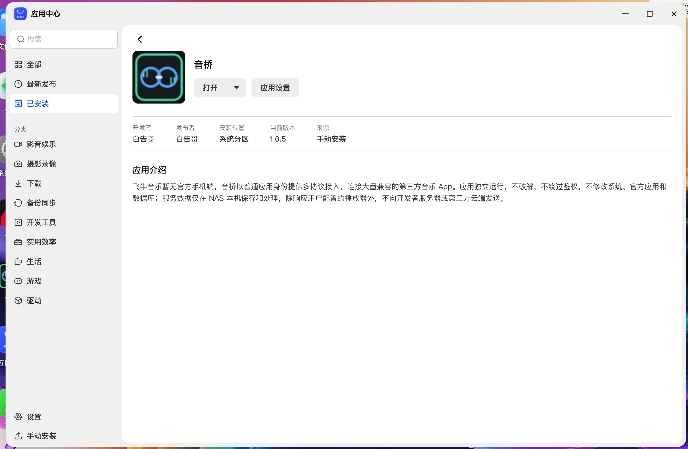
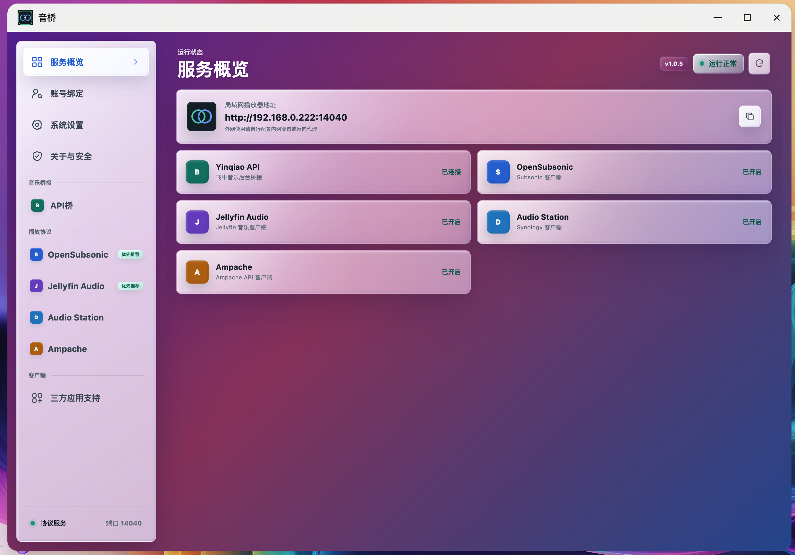
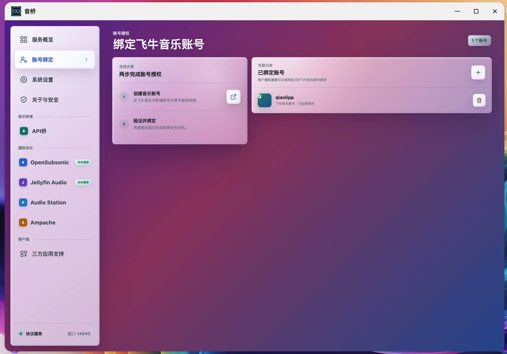
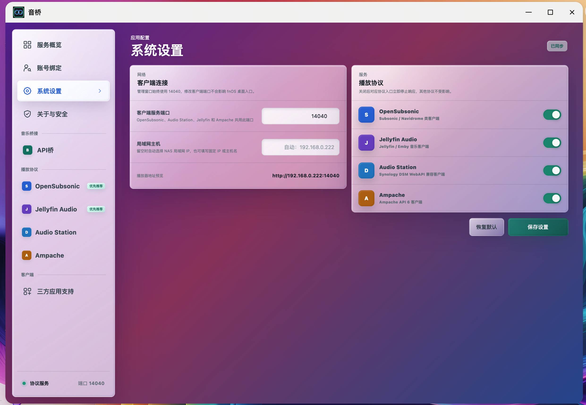
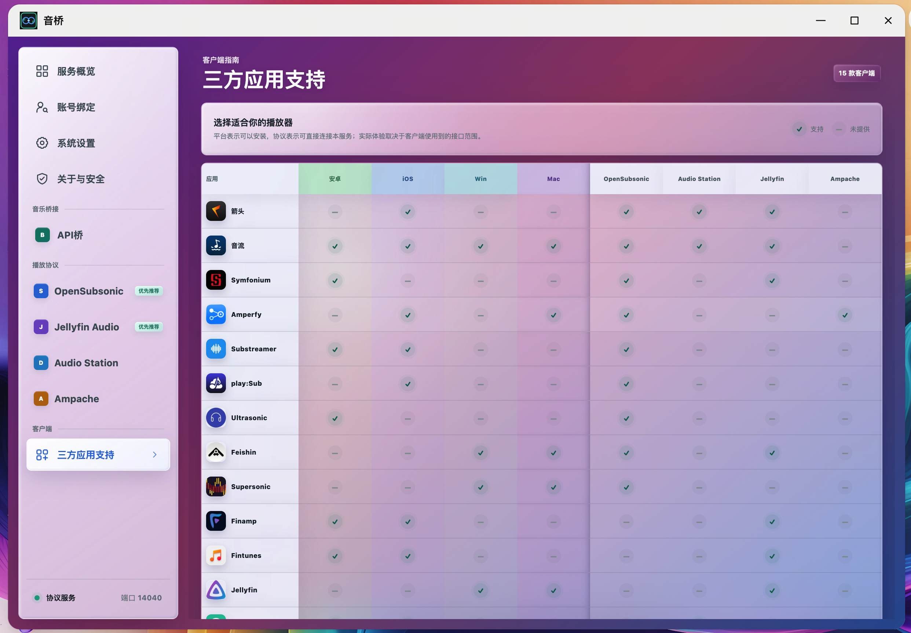
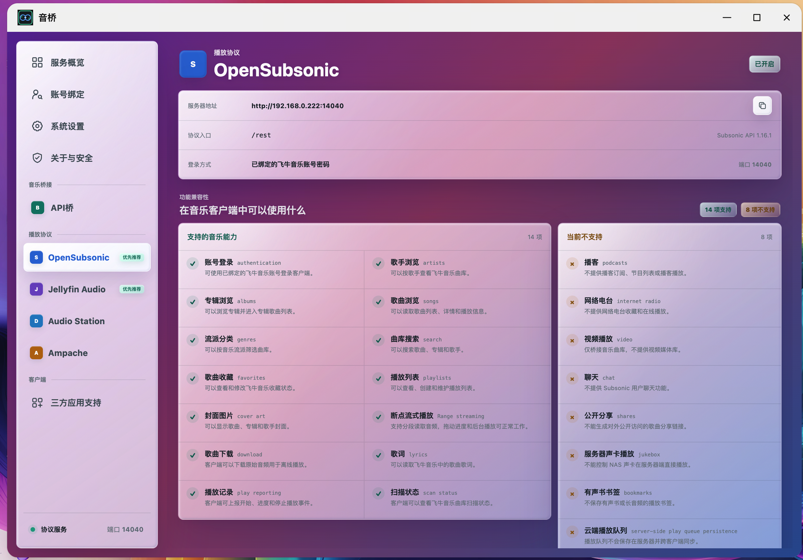
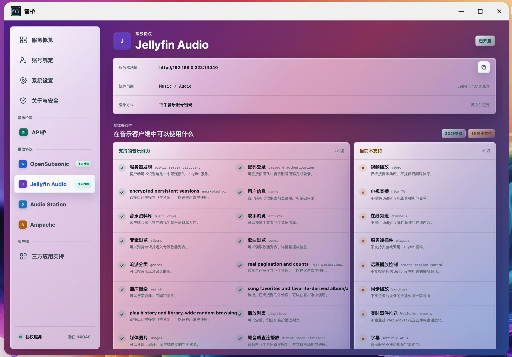
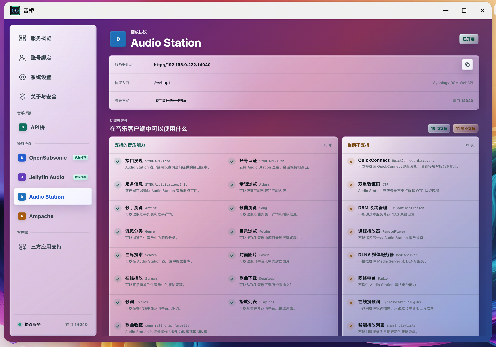
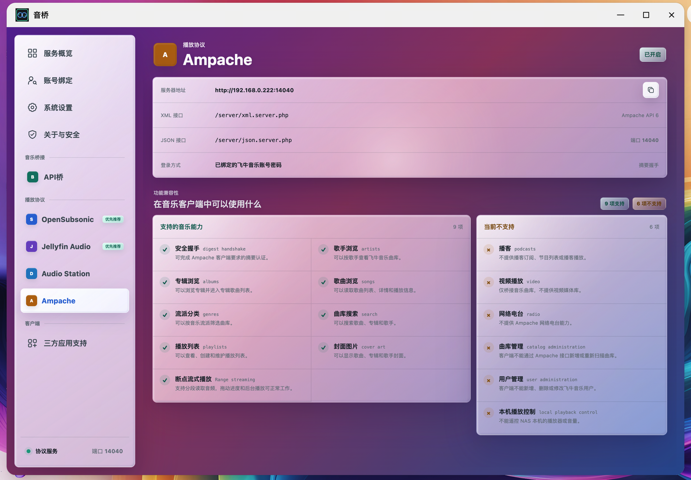

# 音桥

音桥是面向 fnOS 飞牛音乐的第三方播放协议桥。它让手机和桌面音乐客户端通过常见协议
访问飞牛音乐中的歌手、专辑、歌曲、封面、歌词、收藏、歌单和音频流。

## 软件演示

音桥作为独立 fnOS 应用安装和运行，通过统一管理页完成服务检查、账号绑定、端口设置、
协议开关和客户端能力确认。

### 安装与服务概览

<p align="center">
  
  
</p>

### 账号与系统设置

绑定一个或多个飞牛音乐账号后，不同播放器可以使用各自账号登录。协议端口和四种协议
均可独立管理。

<p align="center">
  
  
</p>

### API 与协议能力

管理页会明确展示 API 桥及每种播放协议当前支持和不支持的能力，方便根据客户端选择
合适的接入方式。

<p align="center">
  
  
</p>

<p align="center">
  
  
</p>

<p align="center">
  
  
</p>

<p align="center">
  
</p>

### 在第三方音乐 App 中使用

连接完成后，可以在兼容客户端中浏览曲库、搜索歌曲、切换协议平台并进行完整音频播放。

<p align="center">
  
  
  
  
</p>

## 两层架构

音桥由底层 Yinqiao API 和上层协议适配服务组成：底层连接飞牛音乐服务，上层将已有
曲库能力转换为 OpenSubsonic、Jellyfin Audio、Audio Station 和 Ampache 接口。协议
差异集中在音桥内部处理，播放器只需要连接统一的局域网地址。

## 支持的协议

| 协议 | 适用客户端 | 推荐程度 |
| --- | --- | --- |
| OpenSubsonic / Subsonic | Subsonic、Navidrome 类音乐客户端 | 优先推荐 |
| Jellyfin Audio | Jellyfin、Emby 类音乐客户端 | 优先推荐 |
| Audio Station | Synology Audio Station 兼容客户端 | 可用 |
| Ampache API 6 | Ampache 兼容客户端 | 可用 |

音桥只实现上述协议中的音乐能力，不提供视频、直播、插件或完整媒体服务器功能。各协议
当前支持情况可以直接在应用管理页查看。

## 使用要求

- fnOS `1.2.0300` 或更高版本；
- x86_64 NAS；
- 已安装并正常运行官方飞牛音乐；
- 一个拥有相应曲库权限的飞牛音乐账号。

## 安装

1. 从 [Releases](https://github.com/qianlipp/fn-music-bridge/releases) 下载最新版 FPK。
2. 在 fnOS 应用中心选择手动安装并上传 FPK。
3. 安装完成后，从飞牛桌面打开“音桥”。
4. 在“账号绑定”中添加飞牛音乐账号。
5. 从“服务概览”复制局域网服务器地址并填入播放器。

详细步骤见 [安装与升级](./docs/INSTALL.md) 和 [5 分钟快速上手](./docs/QUICK_START.md)。

## 客户端连接

默认播放器地址为：

```text
http://NAS局域网IP:14040
```

| 客户端类型 | 服务器地址 | 备注 |
| --- | --- | --- |
| Subsonic / Navidrome | `http://NAS_IP:14040` | 不要手动添加 `/rest` |
| Jellyfin | `http://NAS_IP:14040` | 部分客户端可使用 `/Audio` 基础路径 |
| Audio Station | `http://NAS_IP:14040` | 客户端自动访问 `/webapi` |
| Ampache | `http://NAS_IP:14040` | 客户端自动访问 Ampache API |

登录时使用已经在音桥中绑定的飞牛音乐账号和密码。管理页可以绑定多个账号、自定义
播放器端口，并单独开启或关闭每种协议。系统设置会自动检测 fnOS 管理端口、内部 API、
飞牛音乐 Socket 和账号管理地址，也允许在使用自定义 fnOS 端口时手动修正。

## 安全提示

音桥以 fnOS 普通应用账号运行，账号凭据加密保存在 NAS 本机。应用不会自动配置外网
访问，默认 HTTP 端口应只在可信局域网中使用。需要远程访问时，请自行配置 VPN 或带
访问控制的 HTTPS 反向代理，不要直接向公网裸露端口。

常见连接问题见 [FAQ](./docs/FAQ.md)。

## 开源许可

项目原创源码采用 [GNU AGPL v3.0](./LICENSE) 许可。第三方协议名称、产品名称、商标和
播放器图标的权利归各自权利人所有，详见
[THIRD_PARTY_NOTICES.md](./THIRD_PARTY_NOTICES.md)。音桥是社区第三方项目，不是飞牛
官方产品。
